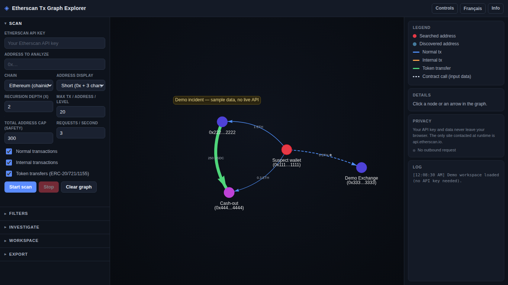

# chainmap

[](https://github.com/gl0bal01/chainmap/actions/workflows/ci.yml)

**English** · [Français](README.fr.md)

> **Map the blockchain.** Turn raw on-chain transactions into an interactive fund-flow
> graph — for OSINT investigators, journalists, and students learning how blockchains work.

Paste an address → chainmap fetches its transactions from the Etherscan v2 API and draws a
directed **address → address** graph, expanded breadth-first to a depth you choose. Then it
layers investigator tooling on top: filters, edge bundling, contract-call decoding, cycle
detection, sink/faucet hubs, and per-node risk scoring.

- **Fully client-side** — no backend, no build step, no telemetry.
- **Your API key and data stay in your browser.** On EVM chains the only
  site contacted is `api.etherscan.io` — plus `api.trongrid.io` (TronGrid) only after you
  explicitly choose Tron, and `coins.llama.fi` (DefiLlama) only while you tick the opt-in
  **Show USD values** box — enforced by a strict Content-Security-Policy.
- **English + French**, fully localized.
- **966 unit/integration tests** on the DOM-free core.



---

## Contents

- [Quick start](#quick-start)
- [Features](#features)
- [Learn how blockchains work](#learn-how-blockchains-work)
- [Architecture](#architecture)
- [Tron (opt-in, via TronGrid)](#tron-opt-in-via-trongrid)
- [Privacy, security & ethics](#privacy-security--ethics)
- [Development & tests](#development--tests)
- [Supported chains](#supported-chains)

---

## Quick start

Zero install — it's native ES modules.

```bash
git clone https://github.com/gl0bal01/chainmap.git && cd chainmap
python3 -m http.server 8000
# open http://localhost:8000/
```

**No API key?** Click **Demo mode** — it loads a bundled sample investigation so you can
explore every feature immediately.

**Live scans:** get a free key at <https://etherscan.io> → *API Keys*, paste it in the UI,
pick a chain, paste an address, **Start**. One key works across all supported chains
(Etherscan v2 is a unified multichain endpoint; some chains need a paid plan — see
[Supported chains](#supported-chains)).

---

## Features

- **BFS expansion** — recurse from a root address to any depth, with a per-address sample
  size, a hard safety cap, and a **Stop** that truly aborts in-flight requests.
- **Load older** — a node whose last fetch returned a full batch gets a **dashed border**
  (more history available). Select it and use **Load older (+N)** in the details panel to
  page further back by block number; new counterparties are added but not explored
  automatically. The cursor is saved in the workspace. A graph can hold several chains:
  every node and edge keeps its own chain, and the same address on two chains is two nodes.
- **Multi-chain graph** — add a chain from the scan form or a node's **Other chains** row. The
  same address on two chains is two nodes. A dotted **same key** link appears only when the
  address signed a transaction on a non-AA chain; "same address only" pairs are listed, never
  drawn. *Known limitation:* on OP-stack/Arbitrum chains Etherscan's `txlist` can include L1→L2
  deposit/system transactions whose sender is an aliased L1 contract, which could read as
  "same key" across two such chains. The link is a signal, not proof of common ownership.
  Not in this version: coloring nodes by chain, and drawing "same address only" links.
- **Three tx families** — normal, internal, and ERC-20/721/1155 token transfers, each a
  colored edge.
- **Calldata decoding** — 4-byte selectors → human method names + **named** decoded args and
  a plain-language `► Summary` line, so a `transfer()`'s real recipient (hidden in calldata)
  is surfaced. Any **human-readable message** carried in a transaction's input (on-chain notes,
  "gm", ransom demands — Latin, Cyrillic, CJK or Arabic) is decoded and shown both in the edge
  details panel *and* directly in the on-graph hover tooltip, so you spot it without a click.
- **Noise reduction** — amount/date/zero-value/spam filters, and edge bundling (collapse
  many A→B transfers into one weighted arrow).
- **Investigation overlays** — round-trip (cycle) detection, sink/faucet hubs (with
  reversible **Hide faucets / Hide sinks** toggles), **peel-chain** detection (highlights
  forwarding chains where value hops through throwaway addresses), color-by-age,
  known-address labels (see below), mixer/bridge/sanctioned tagging (🌀/🌉/⛔ badges), and an
  *explainable* per-node risk score.
- **Likely exchange deposit addresses** (🏦) — an address whose sampled outflow went almost
  entirely (>= 90 % of transfers and of each swept asset's value) to one known exchange hot
  wallet, with at least one sweep in the native coin or a known token (a forged token transfer
  cannot create a mark alone), is marked "likely deposit → `<wallet>`", with its evidence in the details panel and in
  the CSV (`likely_deposit_of`, `deposit_evidence`). A heuristic lead for a compliance request,
  never an attribution. Only addresses whose own transactions were fetched are judged, and only
  wallets listed in `data/` are recognized.
- **Sourced known-address base** — ~580 labels (bridges, routers, mixers, canonical tokens,
  OFAC-sanctioned addresses, a few exchange hot wallets) generated from the official OFAC SDN
  list (sanctions and delistings as of the last data rebuild; the OFAC publish date is shown in
  each sanctioned entry's Source), the MIT superchain registry and a curated seed verified
  against cited official pages, except 9 legacy explorer-label rows marked
  `needs official source`. See [`data/README.md`](data/README.md).
- **Imitation-token detection** — a transfer whose symbol mimics an official token (spoofed
  USDT/USDC, look-alike letters, invisible characters) from a non-official contract gets an
  amber ⓘ flag and is hidden by the spam filter ("Hide known spam tokens"). *Known limitation:*
  legit but uncurated same-symbol contracts (e.g. Wormhole-wrapped USDC/WETH, PulseChain-bridged
  WETH/WBTC on Ethereum) are flagged too: the flag means "not the official contract for this
  symbol on this chain", a signal, not a verdict.
- **Per-edge risk flags** — unlimited/blanket approvals, a hidden real recipient, and
  mixer/bridge/sanctioned counterparties are called out in the edge details panel and
  escalated on the graph in two visual tiers: danger (mixer/bridge/sanctioned, red ⚠) vs informational (approvals/hidden-recipient/imitation tokens, amber ⓘ). **Signals, not verdicts** — always
  corroborate before you conclude.
- **Chain detector** — paste any address; it tells you the chain family (or non-EVM) by format. Then click **Detect chain** to probe ~12 popular chains for on-chain activity and auto-select the one where the address is most active, showing where else it's active.
- **Exports** — PNG, PDF, and CSV (with a sampling caveat baked in, plus decoded method,
  real recipient, decoded amount, and risk-flag columns per edge). Save/load workspaces.
  PNG/PDF carry a provenance footer and the likely-deposit mark; the CSV carries it on line 1.
- **Query log** — every Etherscan request is logged in memory (time, chain, request without
  the API key, HTTP status, row count, SHA-256 of the raw response body, outcome) and shown in
  a panel. Export it as `.json`; it is also saved inside workspaces.
- **Evidence bundle** — one `.zip` (store-only) with `graph.csv`, `graph.png`, `workspace.json`,
  `query-log.json`, a `MANIFEST.json` and a `SHA256SUMS` you check with `sha256sum -c`. The
  zip's own SHA-256 is written in the app log for your case notes. Tamper evidence only.
- **Inferred bridge links** — deposits into known bridges are detected and the expected recipient
  on the other side is decoded from the call, or else assumed to be the depositor's own address (a
  weaker basis, said so). **Look for the release on {chain}** sends up to three requests for that
  recipient there (one page each of normal, internal and token transactions, each logged in the
  query log); candidate releases are drawn **dashed, "inferred — verify"**, with a `low` /
  `medium` / `high` confidence and their evidence (amount, delay, recipient basis, release
  sender). You confirm or reject each one; that decision is recorded as *your assertion* (not
  on-chain proof) in the details panel, the CSV `bridge_inferred` column, PNG/PDF, the evidence
  MANIFEST and the workspace. Never proof, and only from the data already loaded.
- **Search & keyboard navigation** — a **🔍 search button** in the top bar (or **Ctrl/Cmd+K**)
  opens a command palette that searches nodes by address / alias / known-label / category and
  transactions by hash / method (hybrid substring + fuzzy ranking); picking a result focuses +
  selects it and auto-reveals it if hidden by a filter/hub-hide. The button makes search
  reachable on **mobile / touch**, where there's no keyboard shortcut. Ctrl/Cmd+Arrow jumps
  selection to the nearest node in that direction.
- **Historical USD values (opt-in)** — tick **Show USD values** (off at every page load,
  never saved) to get an *estimate* of each transfer's USD value in the edge details panel and
  in a CSV column `usd_value`: DefiLlama's price within 1 h of the transaction × the exact
  token amount (BigInt). Unknown, pending or unpriced is blank, never `0`. NFTs, zero-value,
  imitation-token, spam-list, investigated-contract and unknown-data transfers, testnets and
  unsupported chains are never priced. Every price request is in the query log. See
  [LEARN §11](docs/LEARN.md#usd-estimates).
- **Honest by design** — big-integer amounts (never floating point), failed txs dropped,
  and sampling surfaced everywhere. The sampling caveat applies to every feature above:
  overlays, flags, and hub/peel-chain detection only ever see the sampled graph, never full
  on-chain history.

---

## Learn how blockchains work

chainmap doubles as a **hands-on course**. Every blockchain concept — accounts, the three
transaction families, base units & decimals, calldata, token standards, BFS graphs,
sampling, failed txs, multichain, and investigation heuristics — maps to something you can
*see and do* in the tool, with **8 guided labs**.

📚 **[Full curriculum + labs → docs/LEARN.md](docs/LEARN.md)** · **[en français → docs/LEARN.fr.md](docs/LEARN.fr.md)**

---

## Architecture

Native ES modules, **no bundler**. The design principle: **`graphStore` is the single
source of truth.** Every mutation goes through it; it emits events; the render layer mirrors
it into vis-network DataSets by subscribing. Filters/overlays are a *display projection*
(vis `DataView`s) over that mirror, so the store always holds the full graph for CSV/detail
even when the view is filtered.

```
BFS scan ──► graphStore (truth) ──emits events──► render/network ──► vis DataViews ──► canvas
   ▲               │                                                       ▲
etherscanClient   ui.js / main.js (composition root)              filters · bundling · overlays
   ▲
rateLimiter
```

The correctness-critical core is **DOM-free and unit-tested in Node** (`format`,
`etherscanClient`, `graphStore`, `scanner`, `display`, `roundTrips`, `riskScore`, …). The
DOM/vis layer (`render/*`, `ui.js`) is thin. See [`INTERFACES.md`](INTERFACES.md) for the
frozen module contracts.

---

## Tron (opt-in, via TronGrid)

Tron is not an Etherscan chain, so it is read through **TronGrid** (`api.trongrid.io`) and only
when you ask for it.

- **Choose it:** pick **Tron — via TronGrid (opt-in)** in *Chain*. The choice is per session
  (never saved: a reload shows your last EVM chain). Paste a `T…` address (checksum-verified,
  case kept) or `41…` hex. A `T…` pasted while an EVM chain is selected only shows a hint; no
  request is sent.
- **Key (optional):** a TronGrid API key lifts the rate limit (2 requests/s without one, up
  to 10 with one). It is sent only in the `TRON-PRO-API-KEY` request header, to
  `api.trongrid.io`, and kept like the Etherscan key (the *Remember* toggle applies). No
  Etherscan key is needed for Tron.
- **Sampling:** TronGrid returns at most **200 rows** per request, so the per-address sample is
  capped at 200 (the log says so when the form asks for more). Native TRX/TRC-10, internal and
  TRC-20 transfers are fetched, latest first.
- **Load older** pages by **block time** (TRC-20 and internal rows carry no block number), with
  the cursor saved in the workspace.
- **Not supported on Tron:** known-address labels and sanctions flags, USD values, bridge
  links, same-key/chain twins and other-chain lookups, NFTs, testnets. A Tron sample is never
  complete.

---

## Privacy, security & ethics

**Who sees what:**

| Provider | When | Sees |
|---|---|---|
| Etherscan | EVM scans | EVM addresses, Etherscan key, IP |
| TronGrid | Tron scans | Tron addresses, optional TronGrid key, IP |
| DefiLlama | USD on | coin ids, hour timestamps, IP |

- **Nothing leaves your browser** except calls to `api.etherscan.io` — no backend, proxy,
  analytics, or third-party beacons. `api.trongrid.io` is contacted only after you choose
  Tron (see the table above). One more exception is opt-in: only while **Show USD
  values** is ticked, `coins.llama.fi` (DefiLlama) receives token contract ids (or native-coin
  ids) and hour-rounded times, never the addresses you investigate, a transaction hash or your
  API key. Verify it in DevTools → Network.
- **Vendored libraries** (`vis-network`, `jsPDF`) — no CDN — pinned with **Subresource
  Integrity**. A strict **CSP** limits `script-src` to `'self'` and `connect-src` to the
  Etherscan API, `coins.llama.fi` and `api.trongrid.io`.
- **The API key is never written to any export, log or filename.** The query log keeps only
  the request parameters without the key and a SHA-256 of each response, never response bodies.
- **No untrusted string reaches `innerHTML`** — aliases and API token symbols are rendered
  as DOM text nodes; the analysis is XSS-inert by construction.
- **OSINT ethics:** the graph is a **sample**, not proof. Public-chain data is pseudonymous,
  not anonymous, and not always what it seems (spoofed token names, dust attacks, exchange
  omnibus wallets). Label your limits; corroborate before you conclude.

---

## Development & tests

Tests are **dev-only** (they never run in production and aren't needed to use the app).

```bash
bun install     # dev deps only (happy-dom, playwright-core)
bun test        # 966 unit + integration tests
```

`bun run ci` mirrors every CI job locally (`scripts/ci-local.sh`). Enable the tracked pre-push hook once with:

```bash
git config core.hooksPath .githooks
```

`bun test` covers the DOM-free modules (amount math, dedup keys, BFS guards, failed-tx
filtering, cycle detection, ABI decode, risk scoring, en/fr key parity, …) plus a happy-dom
integration test that drives the real `main.js` against a stubbed vis/fetch. CI runs the
suite and a vendor-integrity check (SRI + SHA-256) on every push.

---

## Supported chains

All 64 Etherscan v2 chains (Ethereum, L2s like Base/Arbitrum/Optimism/Linea/Blast, sidechains like BNB/Polygon/Gnosis/Avalanche, Sonic, and ~30 testnets). One API key is used for every chain — Etherscan v2 is a unified multichain endpoint (but see the paid-plan note below). Each chain carries its **native currency symbol** (so native txs show BNB/POL/AVAX/S/… not "ETH" everywhere). Add one = a single entry in `src/config.js` (`{id, name, explorer, native}`, validated against Etherscan v2's chainlist).

Base, BNB Chain, OP Mainnet, Avalanche (and Gnosis) now require a **paid Etherscan API plan** (an Etherscan policy change, not a chainmap limit); with a free key the app tells you that's the cause instead of a generic error.

**Tron** (opt-in) is read through TronGrid, not Etherscan: see [Tron](#tron-opt-in-via-trongrid). It is not one of the 64 chains above.

## Credits

- Blockchain address-format patterns for the chain detector are adapted from **[gl0bal01](https://github.com/gl0bal01)**'s [`discord-osint-assistant`](https://github.com/gl0bal01/discord-osint-assistant).
- Graph rendering by [vis-network](https://github.com/visjs/vis-network);
- PDF export by [jsPDF](https://github.com/parallax/jsPDF).
- OiY for the idea ;)

## License

[MIT](LICENSE)
