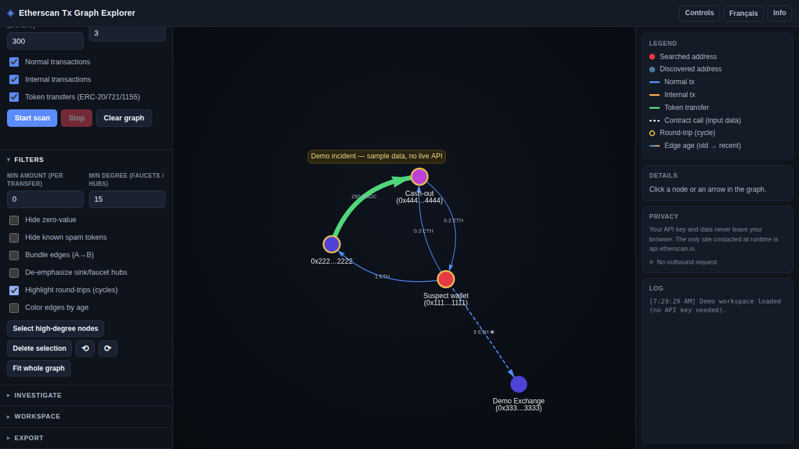
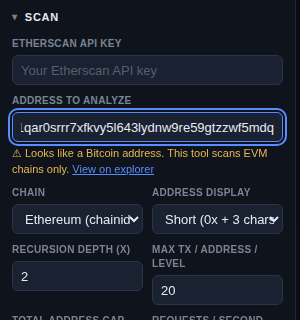

# Comprendre : comment fonctionne une blockchain — avec chainmap

[← Retour au README](../README.fr.md) · [English](LEARN.md) · **Français**

Un **programme pratique**. Chaque concept ci-dessous correspond à quelque chose que vous
pouvez *voir et faire* dans l'outil. Ouvrez **Mode démo** (aucune clé API requise) et suivez
le fil.

---

## Sommaire

1. [Comptes et adresses](#1-comptes-et-adresses)
2. [Transactions — trois familles](#2-transactions--trois-familles)
3. [Valeur, unités de base et décimales](#3-valeur-unités-de-base-et-décimales)
4. [Calldata et sélecteurs de méthode](#4-calldata-et-sélecteurs-de-méthode)
5. [Jetons — ERC-20 / 721 / 1155](#5-jetons--erc-20--721--1155)
6. [Graphe de transactions et expansion BFS](#6-graphe-de-transactions-et-expansion-bfs)
7. [Échantillonnage ≠ historique complet](#7-échantillonnage--historique-complet)
8. [Transactions échouées et annulées](#8-transactions-échouées-et-annulées)
9. [EVM et multichaîne](#9-evm-et-multichaîne)
10. [Heuristiques pour enquêter](#10-heuristiques-pour-enquêter)
11. [Travaux pratiques](#travaux-pratiques)

---

## 1. Comptes et adresses

Un compte sur une chaîne EVM est identifié par une **adresse** de 20 octets — `0x` + 40
caractères hexadécimaux (ex. `0x742d…B78a`). Deux types :

- **EOA** (compte détenu en externe) — contrôlé par une clé privée (une personne / un
  portefeuille).
- **Compte de contrat** — du code qui s'exécute lorsqu'il est appelé.

> **Dans chainmap :** chaque nœud est une adresse. Collez-en une dans *Adresse à analyser* —
> le **détecteur de chaîne** sous le champ vous dit aussitôt s'il s'agit d'une adresse EVM
> (scannable ici) ou d'autre chose (Bitcoin, Solana, Tron…) et vous renvoie vers le bon
> explorateur. Les adresses sont **mises en minuscules** en interne comme identifiant
> canonique ; le libellé affiché (forme courte, votre alias, ou un nom d'adresse connue) ne
> change jamais cet identifiant.

## 2. Transactions — trois familles

chainmap récupère trois types d'activité (les trois cases à cocher) :

- **Normales** — une EOA envoie une tx (transfert de valeur et/ou appel de contrat).
- **Internes** — valeur déplacée *par le code d'un contrat* pendant l'exécution (pas des tx
  signées séparément ; reconstruites par le traceur du nœud).
- **Transferts de jetons** — mouvements ERC-20 / ERC-721 / ERC-1155 (émis comme événements de
  journal).

> **Dans chainmap :** chaque transfert devient une **arête** orientée de l'émetteur vers le
> destinataire, colorée par famille (voir la Légende). C'est le modèle mental central : **une
> blockchain est un registre de mouvements de valeur orientés**, et un graphe en est la forme
> naturelle.

## 3. Valeur, unités de base et décimales

Les blockchains stockent les montants comme des **entiers dans la plus petite unité** (le wei
pour l'ETH : 1 ETH = 10¹⁸ wei). Un jeton déclare ses propres `decimals` (l'USDC en utilise 6).
Pour afficher un montant lisible, on divise par `10^decimals` — avec de l'**arithmétique sur
grands entiers**, jamais de virgule flottante, sous peine de perdre en précision sur de
grandes valeurs.

> **Dans chainmap :** `formatUnits` le fait avec `BigInt`. Si un jeton renvoie des décimales
> erronées/absentes, l'app signale le montant **« décimales inconnues »** au lieu d'afficher
> silencieusement un nombre faux — une règle d'honnêteté qui compte en forensique. La largeur
> des arêtes est **pondérée par le montant**, si bien que les gros flux sont littéralement plus
> épais.

## 4. Calldata et sélecteurs de méthode

*Ce que* fait une transaction. Une tx peut porter des **données d'entrée** (calldata). Un
simple transfert d'ETH a un calldata vide (`0x`). Un appel de contrat encode un **sélecteur de
méthode de 4 octets** (les 4 premiers octets de `keccak256("transfer(address,uint256)")` =
`0xa9059cbb`) suivi des arguments encodés en ABI.

> **Dans chainmap :** les arêtes dont la tx portait du calldata sont dessinées **en pointillés
> avec un `✱`** — on repère les interactions de contrat d'un coup d'œil. Cliquez-en une : le
> panneau de détails **décode le sélecteur** vers sa signature lisible et **décode les
> arguments de tête**. C'est crucial pour l'enquêteur : une tx *normale* appelant `transfer()`
> a son `to` fixé sur le **contrat du jeton**, tandis que le **vrai destinataire** est caché
> dans le calldata — chainmap le révèle.

## 5. Jetons — ERC-20 / 721 / 1155

- **ERC-20** — jetons fongibles (USDC, DAI). `transfer(to, amount)`.
- **ERC-721** — NFT ; chacun a un `tokenId` unique.
- **ERC-1155** — multi-jetons ; identifiants fongibles et non fongibles dans un même contrat.

> **Dans chainmap :** les arêtes de jetons sont dédupliquées sur une **clé précise**
> (`action | hash | from | to | contractAddress | tokenID | logIndex`). Le symbole ne fait
> *pas* partie de la clé — deux contrats différents peuvent tous deux s'appeler « USDC », et
> une seule tx ERC-1155 peut déplacer plusieurs identifiants de jetons. Fusionner sur le
> symbole confondrait des mouvements distincts ; chainmap les garde séparés.

## 6. Graphe de transactions et expansion BFS

En partant de votre adresse (la **racine**, en rouge), chainmap examine ses contreparties,
puis *leurs* contreparties, et ainsi de suite — un **parcours en largeur (BFS)** sur le graphe
d'adresses. La *profondeur de récursion* contrôle le nombre de sauts. La couleur des nœuds
encode la profondeur.

> **Dans chainmap :** augmentez la *profondeur de récursion* pour élargir l'enquête. Des
> garde-fous la maintiennent bornée et peu coûteuse : une taille d'échantillon par adresse, un
> **plafond de sécurité** strict sur le nombre total d'adresses, et un bouton **Arrêter** qui
> interrompt réellement les requêtes en cours. Utilisez d'abord **Estimer le scan** pour prévoir le nombre
> d'appels API et la durée avant un gros parcours.

## 7. Échantillonnage ≠ historique complet

La mise en garde forensique. chainmap récupère les **N dernières** transactions par adresse et
par type — **pas** l'historique complet. Cela garde les scans rapides et bon marché, mais le
graphe est donc un **échantillon**.

> **Dans chainmap :** **Charger les plus anciennes** étend l'échantillon d'un nœud page par page, mais
> l'historique n'est complet que lorsque Etherscan renvoie un lot incomplet pour ce nœud. Une bannière
> persistante et l'export CSV le signalent tous deux.
> **Règle :** ne présentez jamais un graphe échantillonné comme complet ou forensique.
> Augmentez la limite par adresse si nécessaire, et mentionnez toujours l'échantillonnage dans
> vos conclusions.

## 8. Transactions échouées et annulées

Une transaction peut être *incluse dans un bloc tout en échouant* (manque de gaz, un
`revert`). Elle coûte du gaz mais **ne déplace aucune valeur**. Etherscan les marque
(`isError = "1"`, `txreceipt_status = "0"`).

> **Dans chainmap :** les tx échouées sont **écartées avant le tracé des arêtes** — un
> transfert annulé ne doit jamais apparaître comme un mouvement d'argent réel.

## 9. EVM et multichaîne

Ethereum, BSC, Polygon, Arbitrum, Optimism, Base, Avalanche, Sonic… sont toutes
**compatibles EVM** : même format d'adresse, même modèle de tx. Elles diffèrent par leur
**chain id**. Etherscan v2 les expose via **un seul point d'accès**, sélectionné par un
paramètre `chainid`.

> **Dans chainmap :** le sélecteur *Chaîne* ne fait que changer le `chainid`. Comme toutes les
> chaînes EVM partagent le format `0x`-40-hex, une adresse seule **ne peut pas** vous dire à
> quelle chaîne (ni mainnet vs testnet) elle appartient — il faut le contexte des
> transactions. Le détecteur de chaîne rend cette limite explicite.

### Même clé vs même adresse

La signature d'un EOA prouve qu'**une seule clé** contrôle cette adresse sur toutes les
chaînes EVM : la même adresse EOA sur deux chaînes est donc un indice de clé unique (le même
*propriétaire* reste une inférence). Un **contrat** à la même adresse est en général sans
rapport : Multicall3 et Permit2 sont à la même adresse partout, et n'importe qui peut
déployer un autre contrat à une adresse que vous contrôlez sur une autre chaîne. Exemple : en
juin 2022, Wintermute a envoyé 20 M d'OP sur Optimism à l'adresse de son Safe L1 ; ce Safe
n'existait pas sur Optimism, et un attaquant y a déployé un Safe et pris les jetons.

> **Dans chainmap :** la même adresse sur deux chaînes donne deux nœuds. Un lien pointillé
> **même clé** n'est tracé que si l'adresse a signé une transaction normale (`txlist`) sur une
> chaîne qui n'est pas nativement en abstraction de compte. Les paires sans cet indice
> apparaissent comme « même adresse seulement — probablement sans lien » dans la ligne
> *Autres chaînes* du nœud, et ne sont jamais tracées.
>
> **Limite connue :** sur les chaînes OP-stack/Arbitrum, le `txlist` d'Etherscan peut inclure
> des transactions de dépôt/système L1→L2 dont l'émetteur est un contrat L1 aliasé ; cela
> pourrait passer pour « même clé » entre deux telles chaînes. Le lien est un indice, pas une
> preuve de propriété commune. Colorer les nœuds par chaîne et tracer les liens « même adresse
> seulement » ne sont pas dans cette version.

## 10. Heuristiques pour enquêter

Transformer des données en pistes. Les vraies blockchains sont bruitées. chainmap encode les
motifs que recherchent les enquêteurs :

- **Filtres montant / date / valeur-nulle / spam** — couper le bruit pour voir le signal.
- **Regroupement d'arêtes** — fusionner de nombreux transferts A→B en une seule flèche
  pondérée (« N tx, total X »).
- **Hubs puits / source** — adresses qui surtout *reçoivent* (puits) ou surtout *envoient*
  (source), souvent des exchanges / mixeurs / airdrops ; atténuées pour ne pas dominer.
- **Allers-retours (cycles)** — une valeur qui revient à son point de départ (A→B→A, ou des
  boucles plus longues) est un signal classique de **layering / wash trading**. L'algorithme
  SCC de Tarjan cercle chaque adresse d'un cycle.
- **Coloration par ancienneté** — flux anciens froids/ternes → flux récents chauds/vifs, pour
  lire le tempo.
- **Libellés d'adresses connues et risk-flags** — une liste locale intégrée nomme des entités
  bien connues — pas seulement des contrats (WETH, USDC, routeurs) mais aussi des
  **exchanges, ponts, mixeurs et adresses sanctionnées par l'OFAC**, sur plusieurs chaînes —
  **sans aucune requête réseau**. Les catégories à fort signal alimentent les **risk-flags** :
  une arête dont le destinataire est un mixeur, un pont ou une entité sanctionnée est escaladée
  sur le graphe, et le panneau de détails d'un nœud affiche le libellé plus une ligne
  **Source** donnant la provenance (ex. une action OFAC, ou un libellé public d'explorateur).
  La liste est un **instantané daté, pas un flux de sanctions en direct** — vérifiez contre la
  liste OFAC SDN officielle avant d'agir sur un résultat `sanctioned`.
- **Score de risque par nœud** — un chiffre de triage *explicable* combinant ce qui précède
  (sur un cycle, hub, degré élevé, appels de contrat, entité connue). Cliquez un nœud pour
  voir le score **et toutes les raisons** — aucune boîte noire.
- **Adresses de dépôt d'une plateforme d'échange** — voir la sous-section ci-dessous.

### Adresses de dépôt d'une plateforme d'échange

Les plateformes d'échange centralisées donnent à chaque client une **adresse de dépôt
unique**. Ce que le client y envoie est ensuite **balayé** (transféré, en général vite et
presque en totalité) vers l'un des portefeuilles chauds de la plateforme. Une adresse dont les
sorties vont presque toutes vers **un seul portefeuille connu** d'une plateforme est donc
probablement une adresse de dépôt de celle-ci : c'est la piste à porter auprès de la
plateforme dans une demande de conformité.

chainmap marque une telle adresse « dépôt probable → `<portefeuille>` » quand tout ceci est vrai :

- **Ses propres transactions ont été récupérées**, natives comme jetons. Sinon ses sorties
  dans le graphe ne sont que ce que les requêtes d'autres nœuds ont laissé voir, et elle n'est
  jamais jugée.
- Elle n'est pas elle-même une entité connue, et elle a envoyé de la valeur à **un seul**
  portefeuille connu de plateforme.
- **La règle 90/90 :** au moins 90 % de ses transferts sortants (en nombre) sont allés à ce
  portefeuille et, pour chaque actif balayé, au moins 90 % de la valeur (BigInt sur les unités
  de base, pourcentage arrondi à l'inférieur : 99,9 % n'apparaît jamais comme 100 %). Les
  jetons imitation et spam sont ignorés pour que des transferts d'empoisonnement ne diluent pas
  l'indice.

Le panneau de détails montre les indices : « N transferts sortants sur M », la part par actif
et une **ligne de délai** (« balayé moins de 10 minutes après la dernière entrée »). Le délai
utilise le même filtre que les sorties (action récupérée, valeur > 0, ni imitation ni spam) et
il est affiché, pas exigé : les politiques de balayage vont de quelques minutes à plusieurs
semaines, et l'entrée est souvent hors de l'échantillon.

Limites, à lire avant de se fier à une marque :

- Tout repose sur des **données échantillonnées** ; l'indice vaut ce que vaut la récupération
  des N dernières transactions.
- **1 sur 1 suffit.** Une adresse de dépôt ne sert souvent qu'une fois ; le compte est affiché
  pour que vous le pesiez.
- Seuls les portefeuilles de `data/` sont reconnus ; les autres plateformes restent invisibles.
- Un flux réparti entre deux portefeuilles de plateforme reste non marqué (cela pourrait être
  deux plateformes).
- Le jugement se fait **par chaîne** ; la même adresse sur deux chaînes est jugée deux fois,
  indépendamment.
- C'est une **piste, pas une preuve de propriété** : vérifiez auprès de la plateforme.

Exemple : dans la démo, `0xdec0…0001` est alimentée par la racine puis balayée vers Binance 14
dix minutes plus tard ; elle est donc marquée (données illustratives).

---

## Travaux pratiques

Chargez **Mode démo**, puis déroulez ces exercices. Chacun nomme le(s) concept(s) qu'il
travaille.

1. **Lire le graphe.** Repérez la racine (rouge). Suivez les flèches — qui a envoyé à qui, et
   combien ? Quelle arête est la plus épaisse, et pourquoi ?
   *(→ Transactions, Valeur et décimales)*
2. **Trouver l'appel de contrat.** Une arête est en pointillés avec un `✱`. Cliquez-la : quelle
   méthode a été appelée ? Quels sont les arguments décodés ? Pourquoi un *transfert de valeur*
   est-il aussi un appel de contrat ? *(→ Calldata et sélecteurs)*
3. **Repérer le layering.** Activez **Surligner les allers-retours**. Quelles adresses reçoivent un
   anneau ambre ? Tracez le cycle à la main. Pourquoi un flux qui revient est-il suspect ?
   *(→ Heuristiques pour enquêter)*
4. **Couper le bruit.** Réglez un *Montant min.*, activez *Masquer valeur nulle*, puis
   **Regrouper les arêtes**. Comment le signal lisible change-t-il ? *(→ Heuristiques pour enquêter)*
5. **Trier par risque.** Cliquez chaque nœud et lisez sa ligne **Risque**. Classez les adresses.
   Laquelle enquêteriez-vous en premier, et quelles preuves motivent ce choix ?
   *(→ Heuristiques pour enquêter)*
6. **Respecter l'échantillon.** Notez la bannière d'échantillonnage. Si c'était réel, que
   faudrait-il faire avant de qualifier une conclusion de complète ? *(→ Échantillonnage)*
7. **Détecter la chaîne.** Collez une adresse Bitcoin (`1A1zP1eP5QGefi2DMPTfTL5SLmv7DivfNa`)
   dans le champ d'adresse. Que vous dit chainmap, et pourquoi ne peut-il pas la scanner ?
   *(→ Comptes, Multichaîne)*
8. **Produire des preuves.** Ajoutez une note, exportez en **PNG** et **CSV**. Que préserve le
   CSV que l'image ne montre pas ? *(→ Panneau Export)*

*Conseil pour l'enseignant :* construisez un petit `data/demo-workspace.json` d'un incident
connu et faites reconstruire l'histoire par les étudiants à partir du seul graphe.

---

[← Retour au README](../README.fr.md) · [English](LEARN.md)
