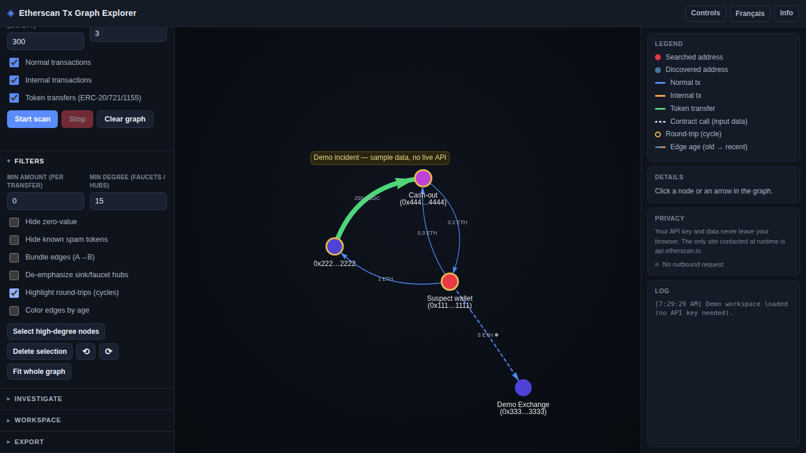
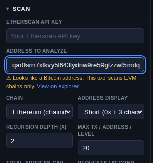

# Learn: how a blockchain works — with chainmap

[← Back to README](../README.md) · **English** · [Français](LEARN.fr.md)

A **hands-on curriculum**. Each concept below maps to something you can *see and do* in
the tool. Open **Demo mode** (no API key needed) and follow along.

---

## Contents

1. [Accounts & addresses](#1-accounts--addresses)
2. [Transactions — three families](#2-transactions--three-families)
3. [Value, base units & decimals](#3-value-base-units--decimals)
4. [Calldata & method selectors](#4-calldata--method-selectors)
5. [Tokens — ERC-20 / 721 / 1155](#5-tokens--erc-20--721--1155)
6. [The transaction graph & BFS expansion](#6-the-transaction-graph--bfs-expansion)
7. [Sampling ≠ full history](#7-sampling--full-history)
8. [Failed & reverted transactions](#8-failed--reverted-transactions)
9. [The EVM & multichain](#9-the-evm--multichain)
10. [Investigation heuristics](#10-investigation-heuristics)
11. [Evidence & provenance](#11-evidence--provenance)
12. [Hands-on labs](#hands-on-labs)

---

## 1. Accounts & addresses

An account on an EVM chain is identified by a 20-byte **address** — `0x` + 40 hexadecimal
characters (e.g. `0x742d…B78a`). Two kinds:

- **EOA** (externally-owned account) — controlled by a private key (a person/wallet).
- **Contract account** — code that runs when called.

> **In chainmap:** every node is an address. Paste one into *Address to analyze* — the
> **chain detector** under the field tells you instantly whether it's an EVM address
> (scannable here) or something else (Bitcoin, Solana, Tron…) and links you to the right
> explorer. Addresses are **lowercased** internally as their canonical id; the label you
> see (short form, your alias, or a known-address name) never changes that id.

## 2. Transactions — three families

chainmap fetches three kinds of activity (the three checkboxes):

- **Normal** — an EOA sends a tx (value transfer and/or a contract call).
- **Internal** — value moved *by contract code* during execution (not separately signed;
  reconstructed by the node's tracer).
- **Token transfers** — ERC-20 / ERC-721 / ERC-1155 movements (emitted as log events).

> **In chainmap:** each transfer becomes a directed **edge** from sender to receiver,
> colored by family (see the Legend). This is the core mental model: **a blockchain is a
> ledger of directed value movements**, and a graph is its natural shape.

## 3. Value, base units & decimals

Blockchains store amounts as **integers in the smallest unit** (wei for ETH: 1 ETH =
10¹⁸ wei). A token declares its own `decimals` (USDC uses 6). To show a human amount you
divide by `10^decimals` — using **big-integer math**, never floating point, or you lose
precision on large values.

> **In chainmap:** `formatUnits` does this with `BigInt`. If a token reports bad/missing
> decimals, the app flags the amount **"decimals unknown"** instead of silently showing a
> wrong number — an honesty rule that matters in forensics. Edge width is **weighted by
> amount**, so large flows are literally thicker.

## 4. Calldata & method selectors

*What* a transaction did. A tx can carry **input data** (calldata). A plain ETH transfer
has empty calldata (`0x`). A contract call encodes a **4-byte method selector** (first 4
bytes of `keccak256("transfer(address,uint256)")` = `0xa9059cbb`) followed by ABI-encoded
arguments.

> **In chainmap:** edges whose tx carried calldata are drawn **dashed with a `✱`** — spot
> contract interactions at a glance. Click one: the details panel **decodes the selector**
> to its human signature and **decodes the leading arguments**. This matters for
> investigators: a *normal* tx calling `transfer()` has its `to` set to the **token
> contract**, while the **real recipient** is hidden in the calldata — chainmap surfaces it.

## 5. Tokens — ERC-20 / 721 / 1155

- **ERC-20** — fungible tokens (USDC, DAI). `transfer(to, amount)`.
- **ERC-721** — NFTs; each has a unique `tokenId`.
- **ERC-1155** — multi-token; both fungible and non-fungible ids in one contract.

> **In chainmap:** token edges are deduplicated on a **precise key**
> (`action | hash | from | to | contractAddress | tokenID | logIndex`). Symbol is *not*
> part of the key — two different contracts can both call themselves "USDC", and one
> ERC-1155 tx can move several token ids. Collapsing on symbol would merge distinct
> movements; chainmap keeps them separate.

## 6. The transaction graph & BFS expansion

Starting from your address (the **root**, red), chainmap looks at its counterparties, then
*their* counterparties, and so on — a **breadth-first search (BFS)** over the address
graph. *Recursion depth* controls how many hops out it goes. Node color encodes depth.

> **In chainmap:** raise *Recursion depth* to widen the investigation. Guards keep it
> bounded and cheap: a per-address sample size, a hard **safety cap** on total addresses,
> and a **Stop** that truly aborts in-flight requests. Use **Estimate scan** first to
> predict API calls + time before a big run.

## 7. Sampling ≠ full history

The forensic caveat. chainmap fetches the **latest N** transactions per address per type —
**not** the complete history. This keeps scans fast and cheap, but it means the graph is a
**sample**.

> **In chainmap:** **Load older** extends a node's sample one page at a time, but the node's history is
> never complete until Etherscan returns a short batch for that node. A persistent banner and the CSV
> export both state this. **Rule:** never present a sampled graph as complete or forensic.
> Increase the per-address limit if you need more, and always note the sampling in findings.

## 8. Failed & reverted transactions

A transaction can be *included in a block yet fail* (out of gas, a `revert`). It costs gas
but **moves no value**. Etherscan marks these (`isError = "1"`, `txreceipt_status = "0"`).

> **In chainmap:** failed txs are **dropped before drawing edges** — a reverted transfer
> must never appear as real money movement.

## 9. The EVM & multichain

Ethereum, BSC, Polygon, Arbitrum, Optimism, Base, Avalanche, Sonic… are all
**EVM-compatible**: same address format, same tx model. They differ by **chain id**.
Etherscan v2 exposes them through **one endpoint**, selected by a `chainid` parameter.

> **In chainmap:** the *Chain* selector just changes `chainid`. Because every EVM chain
> shares the `0x`-40-hex format, an address alone **cannot** tell you which chain (or
> mainnet vs testnet) it belongs to — you need transaction context. The chain detector
> makes this limitation explicit.

### Same key vs same address

An EOA's signature proves that **one key** controls that address on every EVM chain, so the
same EOA address on two chains is evidence of one key (same *owner* is still an inference).
A **contract** at the same address is usually unrelated: Multicall3 and Permit2 sit at the
same address everywhere, and anyone can deploy a different contract at an address you
control on another chain. Example: in June 2022, Wintermute sent 20M OP on Optimism to its
L1 Safe address; the Safe did not exist on Optimism, and an attacker deployed a Safe there
and took the tokens.

> **In chainmap:** the same address on two chains is two nodes. A dotted **same key** link is
> drawn only when the address signed a normal transaction (`txlist`) on a chain that is not
> natively account-abstracted. Pairs with no such evidence show up as "same address only —
> likely unrelated" in the node's *Other chains* row and are never drawn.
>
> **Known limitation:** on OP-stack/Arbitrum chains Etherscan's `txlist` may include L1→L2
> deposit/system transactions whose sender is an aliased L1 contract; that could read as
> "same key" across two such chains. The link is a signal, not proof of common ownership.
> Coloring nodes by chain and drawing "same address only" links are not in this version.

## 10. Investigation heuristics

Turning data into leads. Real blockchains are noisy. chainmap encodes patterns
investigators look for:

- **Amount / date / zero-value / spam filters** — cut noise to see the signal.
- **Edge bundling** — collapse many A→B transfers into one weighted arrow ("N tx, total X").
- **Sink / faucet hubs** — addresses that mostly *receive* (sink) or mostly *send*
  (faucet), often exchanges/mixers/airdrops; de-emphasized so they don't dominate.
- **Round-trips (cycles)** — value that returns to where it came from (A→B→A, or longer
  loops) is a classic **layering / wash-trading** signal. Tarjan's SCC algorithm rings
  every address on a cycle.
- **Color by age** — old flows cool/dim → recent flows warm/bright, to read tempo.
- **Known-address labels & risk flags** — a bundled local list names well-known entities —
  not just contracts (WETH, USDC, routers) but **exchanges, bridges, mixers, and
  OFAC-sanctioned addresses**, across several chains — with **no network lookup**. The
  high-signal categories drive the **risk flags**: an edge whose recipient is a mixer,
  bridge, or sanctioned entity is escalated on the graph, and a node's details panel shows
  the label plus a **Source** line giving the label's provenance (e.g. an OFAC action, or a
  public explorer label). The list is a **dated snapshot, not a live sanctions feed** —
  verify against the live OFAC SDN list before acting on a `sanctioned` hit.
- **Per-node risk score** — an *explainable* triage number combining the above (on a cycle,
  hub, high degree, contract calls, known entity). Click a node to see the score **and
  every reason** — no black box.
- **Exchange deposit addresses** — see the subsection below.



### Exchange deposit addresses

Custodial exchanges give each customer a **unique deposit address**. Whatever a customer
sends there is later **swept** (forwarded, usually soon and nearly in full) to one of the
exchange's hot wallets. So an address whose outflow goes almost entirely to **one known
exchange wallet** is probably a deposit address of that exchange, and that is the lead you
take to the exchange in a compliance request.

chainmap marks such an address "likely deposit → `<wallet>`" when all of this holds:

- **Its own transactions were fetched**, both native and token ones. Otherwise its outflows
  in the graph are only what other nodes' fetches happened to show, and it is never judged.
- It is not itself a known entity, and it sent value to **exactly one** known exchange wallet.
- **The 90/90 rule:** at least 90 % of its outgoing transfers (by count) went to that wallet,
  and, for each asset swept, at least 90 % of the value (BigInt on raw units, percent floored,
  so 99.9 % never reads as 100 %). Fake transfers of imitation or spam-listed tokens are
  ignored.
- **At least one sweep is in the chain's native coin or a known token** (listed in `data/`).
  Anyone can deploy a token whose contract emits a fake `Transfer` from any address, so a
  forged token transfer cannot create a mark on its own.

The details panel shows the evidence: "forwarded N of M outgoing transfers", the share per
asset, and a **delay line** ("swept within 10 minutes of the latest inflow"). The delay uses
the same filter as outflows (fetched action, value > 0, not imitation/spam) and is shown, not
required: sweep policies run from minutes to weeks, and the inflow is often outside the sample.

Limits, read them before relying on a mark:

- It rests on **sampled data**; the evidence is only as complete as the latest-N fetch.
- **1 of 1 qualifies.** Deposit addresses are often used once, so the count is shown for you
  to weigh.
- Only wallets in `data/` are recognized; other exchanges stay invisible.
- A flow split across two exchange wallets stays unmarked (could be two exchanges).
- **Spoofed transfers can still hide a deposit.** Fake transfers of an unknown token count
  as outgoing transfers, so they can push a real deposit address below the 90 % share.
- **Assets never swept to the wallet are not value-judged.** A large transfer of another
  asset elsewhere counts only as one transfer against the 90 % count share.
- It is judged **per chain**; the same address on two chains is judged twice, independently.
- It is a **lead, not proof of ownership**: verify with the exchange.

Worked example: in the demo, `0xdec0…0001` is funded by the root and swept to Binance 14
ten minutes later, so it is marked (illustrative data).

---

## 11. Evidence & provenance

A picture of a graph is easy to doubt: when was it made, from what data, could it have been
edited? chainmap keeps a **query log** and can pack everything into an **evidence bundle** so
that you, or a reader, can check the files were not changed after export.

**What the query log records.** One entry per Etherscan request attempt (a retry is its own
entry; an attempt cancelled with **Stop** is not logged): time (UTC), chain, action, the request parameters **without your API key**, HTTP
status, number of rows returned, the **SHA-256 of the raw response body**, and an outcome
(ok, retried, error, no response). Only the hash is kept, never the response itself: the log
stays small and holds no response data, yet anyone holding the same raw response can check
that it matches. The API key is removed before anything is stored. Open the **Query log**
panel to read it, or use **Export query log (.json)**. The log is also saved inside workspaces.

**What the bundle holds.** **Evidence bundle (.zip)** downloads `chainmap-evidence-<UTC time>.zip`:

- `graph.csv` and `graph.png` (the PNG is left out if it would exceed the pixel cap, and the
  manifest says so under `omitted`), both showing the full graph regardless of on-screen
  filters, with provenance (footer on the PNG, line 1 of the CSV);
- `workspace.json`, which reloads the graph;
- `query-log.json`;
- `MANIFEST.json`: app version, export time, chains, roots, graph size, sampling settings,
  retrieval window, the known-address snapshot, the caveats, and the SHA-256 of each file;
- `SHA256SUMS`: the same hashes as `MANIFEST.json`, plus the hash of `MANIFEST.json` itself,
  in a format standard tools check.

**How to verify it.**

```bash
unzip chainmap-evidence-*.zip -d case && cd case && sha256sum -c SHA256SUMS
```

Every line must say `OK`. On macOS use `shasum -a 256 -c SHA256SUMS`. On Windows use
`Get-FileHash` (PowerShell) and compare the values by hand. Then **write the SHA-256 of the
zip itself** (shown in the app log right after export) in your case notes, or give it to a
third party: later, hashing the zip again must give the same value.

**Limits. Read them before you rely on a bundle.**

- **Tamper evidence, not a signature.** The hashes show that files changed after export. They
  do not prove *when* the bundle was made or *who* made it: whoever can rebuild the zip can
  rebuild the hashes too. A timestamp or a signature from a third party is what adds that.
- **Sampled data.** Scans fetch the latest transactions per address (see section 7). The
  bundle says so; it is never the full on-chain history.
- **The log records requests, not proof that it explains every record.** It includes probes
  that added no graph data (scan estimate, chain detection, "check other chains"), and
  deleting nodes does not delete log entries.
- **"Partial".** If part of the graph came from the demo, or from a workspace saved without a
  query log (or with invalid log entries), or if old log entries were dropped at the log
  limit, the footer and the manifest say that part of the graph has no logged retrieval.
  Otherwise the manifest's `retrieval.fullyLogged` is `true`. That only means nothing was
  dropped or left unlogged; it does not mean the data is complete: requests may have failed,
  scans may have been stopped, and the data is sampled.
- **Labels and heuristics are signals, not facts.** Known labels, risk flags, imitation-token
  marks, likely-deposit marks (also drawn in the PNG/PDF) and same-key links are leads to
  corroborate. Known labels come from a dated snapshot, recorded in the manifest.

### USD estimates

"How much was that worth?" is a different question from "how much was it?". chainmap can
answer it with an **estimate**, but only if you ask: tick **Show USD values** in the
Investigate panel. The box is **off every time the page loads** and is never saved (not in
the browser, not in workspaces). While it is off, chainmap makes **no** request to the price
provider: not at load, not on a scan, the demo, a workspace load, the details panel or an export.

**What is sent, and what never is.** Once ticked, chainmap asks DefiLlama's free coins API
(`coins.llama.fi`, no key) for historical prices, in batches, on a queue of its own (1
request per second, separate from your Etherscan quota). A request contains only:

- **coin ids**: `<chain slug>:<token contract>` (for example `ethereum:0xa0b8…`) or a native
  coin id (`coingecko:ethereum`), lowercase;
- **hour-rounded Unix times**;
- `searchWidth=30m`.

It never contains an investigated address (any sender, receiver or root), a transaction hash,
your Etherscan key or any free text, and the request carries no cookies and no referrer. Like
any web request, it still shows DefiLlama your IP address, and the token contracts tell it
which assets you are looking at. A token contract that is a **root on any chain** of your graph
is never sent (checked when the request is built and again just before it leaves). The
request is also recorded in your query log (see below).

**The nearest-hour bucket.** Each transaction time is rounded to the **nearest hour** (its
bucket) and the API is asked for the price within **±30 minutes** of that hour. The two
errors add up: the price used is within **1 hour** of the transaction. The details panel
shows the data point's own time (UTC), so you can see how close it really is. For a stable
asset that hardly matters; for a volatile token on a quiet day it can.

**The confidence rule.** DefiLlama attaches a `confidence` to most data points but documents
no threshold. The 0.9 cut-off is **chainmap's own rule**: a point whose confidence is present
and below 0.9 is treated as unknown. A point with **no** confidence (older points often lack
it) is accepted, and the details panel shows the confidence as "—".

**What is never priced.** These transfers get no price, and the details panel says why
("not priced (...)"):

- **NFTs** (ERC-721 / ERC-1155);
- **zero-value** transfers;
- **imitation tokens** and tokens on the **spam list**: a fake "USDT" is never given the real
  USDT's price, because pricing goes by contract, never by symbol;
- tokens whose contract is a **root** of your graph (an investigated address);
- chains DefiLlama does not cover, **testnets**, and a few gaps: the **native coin of
  Fraxtal** (its gas token changed on a disputed date, and the two prices differ about
  1000x) and **tokens on MemeCore** (no DefiLlama chain slug; only its native coin is priced);
- transfers whose amount, decimals or time are unknown;
- **bundled edges** (an A→B total is not a transaction): unbundle to see per-transfer values.

An unknown, pending, failed or low-confidence price is shown as such and left **blank in the
CSV, never `0`**. A positive amount worth under a cent shows as "< 0.01".

**Fail closed.** The imitation and spam checks need the bundled known-address data and the
spam list. If either failed to load, chainmap requests **no** price for the whole session
and writes one error line in the app log. A request that fails is handled quietly: a 429 or
5xx is retried up to 3 times (honouring `Retry-After`); a timeout, a network error or any
other 4xx is not retried and the transfer shows "price request failed". It is asked again
the next time the graph changes or the box is ticked again. A price failure never slows or stops a scan.

**Evidence.** Every price request is an entry in the **query log** (source DefiLlama, action
`batchHistorical`, the `coins` and `searchWidth` parameters, status, rows, SHA-256 of the
body), and it is logged **before** its value can appear on screen. In the panel, the address
column shows how many coins the request carried. Entries stay after you untick the box, and
they are cleared with the rest of the log on Reset, workspace load or demo. In the
CSV, `usd_value` is the **last** column, and line 1 says the values are estimates and how many
of the priceable transfers were priced. In the evidence bundle, `MANIFEST.json` gets a
`prices` block (source, `estimate: true`, whether USD was shown, the number of queries, priced
and priceable transfers), and the USD caveat is added to its caveats. The PNG/PDF show no USD.

**Limits. It is an estimate, not a fact.**

- The price is DefiLlama's, within 1 hour of the transaction. It is not the price the sender
  or receiver got, and a value is an amount times a price, nothing more.
- **Long-tail tokens** have sparse price data: many transfers will stay blank. **Young chains
  and tokens** have nothing before their listing, so early transfers are blank, which is the
  correct answer.
- **Polygon's native coin** changed from MATIC to POL on 2024-09-10 (Unix 1725926400);
  chainmap uses the matching coin on each side of that date.
- DefiLlama is a third party: its data can be revised, and chainmap cannot vouch for it.
  Cross-check anything that matters (a court filing, a report) against a second source.

---

## Hands-on labs

Load **Demo mode**, then work through these. Each names the concept(s) it exercises.

1. **Read the graph.** Identify the root (red). Follow the arrows — who sent to whom, and
   how much? Which edge is thickest, and why? *(→ Transactions, Value & decimals)*
2. **Find the contract call.** One edge is dashed with `✱`. Click it: what method was
   called? What were the decoded arguments? Why is a *value transfer* also a contract call?
   *(→ Calldata & selectors)*
3. **Spot the layering.** Turn on **Highlight round-trips**. Which addresses get an amber
   ring? Trace the cycle by hand. Why is a returning flow suspicious?
   *(→ Investigation heuristics)*
4. **Cut the noise.** Set a *Min amount*, toggle *Hide zero-value*, then **Bundle edges**.
   How does the readable signal change? *(→ Investigation heuristics)*
5. **Triage by risk.** Click each node and read its **Risk** row. Rank the addresses.
   Which would you investigate first, and what evidence drives that?
   *(→ Investigation heuristics)*
6. **Respect the sample.** Note the sampling banner. If this were real, what would you need
   to do before calling any conclusion complete? *(→ Sampling)*
7. **Detect the chain.** Paste a Bitcoin address (`1A1zP1eP5QGefi2DMPTfTL5SLmv7DivfNa`) into
   the address field. What does chainmap tell you, and why can't it scan it?
   *(→ Accounts, Multichain)*
8. **Produce evidence.** Add a sticky note, export **PNG** and **CSV**. What does the CSV
   preserve that the picture doesn't? *(→ Export panel)*

*Instructor tip:* build a small `data/demo-workspace.json` of a known incident and have
students reconstruct the story from the graph alone.



---

[← Back to README](../README.md) · [Français](LEARN.fr.md)
